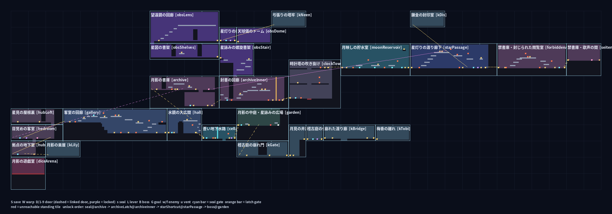

# ステージ作成ガイド / Stage Authoring Guide — 海音ちゃんの冒険２ (ROCKSIDE II)

> ピッちゃん（ChatGPT）や他のAIが部屋を追加・修正するための手順書です。**部屋はすべて `src/03b_rooms.js` の文字の絵（ASCII）で作ります。座標を手で書かないでください。**
> This is the how-to for ChatGPT ("ピッちゃん") or any other AI that adds or edits rooms. **Every room is drawn as ASCII in `src/03b_rooms.js`. Never hand-write pixel rectangles.**



---

## 1. しくみ / How it works

- 1文字 = 16×16px のタイル1枚。/ One character = one 16×16 px tile.
- 部屋は「画面（セル）」単位。1セル = 256×240px = **16列×15行**。部屋の大きさは `cw×ch` セル（行数・列数は必ず16と15の倍数）。/ Rooms are measured in screens ("cells"): 1 cell = 256×240 px = **16 columns × 15 rows**. A room is `cw × ch` cells, so its row length must be a multiple of 16 and its row count a multiple of 15.
- 各部屋は世界地図上の位置 `cx, cy`（セル単位）を持ちます。部屋同士は重なってはいけません。ゲーム内マップは悪魔城のようにこのセルで描かれます。/ Each room has a world-grid position `cx, cy` in cells. Rooms must not overlap. The in-game map is drawn from these cells, Castlevania-style.
- `buildMansionWorld(ROOM_DEFS)` が文字の絵から `MR`（当たり判定・扉・セーブ・敵・小物）、`MANSION_PORTALS`（ワープ）、`MANSION_PROPS`（壊せる小物）を自動生成します。ボス・セーブ・フラグの処理は `src/04i_mansion.js` のまま動きます。/ It generates `MR` (collision, doors, saves, enemies, props), `MANSION_PORTALS` and `MANSION_PROPS` from the ASCII. Bosses, saves and flags in `src/04i_mansion.js` keep working unchanged.
- 描画は当たり判定とまったく同じタイルを、エリアごとの色で描きます（背景の絵は飾りなので、足場の参考にしないこと）。/ The renderer draws exactly the collision tiles, styled per area. The painted backdrop is decoration only, so never use it to place floors.

## 2. タイルの記号 / Tile legend

| 文字 | 意味 (JA) | Meaning (EN) |
|---|---|---|
| `#` | 壁・床（固い） | solid wall / floor |
| `=` | 薄い足場（タイルの上半分8pxだけ固い。下からはすり抜けない） | thin ledge (solid top 8 px; still solid from below) |
| `.` | 空気 | empty air |
| `\|` | 空気（昇降機の通り道の目印。任意） | air, optional lift-shaft marker |
| `g` | 封印の門（`seal` フラグまで固い） | seal gate (solid until flag `seal`) |
| `k` | 錠の門（その部屋の `lever.flag` まで固い） | latch gate (solid until this room's `lever.flag`) |

**目印（床のすぐ上の空気マスに置く）/ Markers (put them in the air tile directly above the floor they stand on).** The marker's x is the tile centre and its y is the tile bottom, i.e. the floor surface.

| 文字 | 意味 (JA) | Meaning (EN) |
|---|---|---|
| `S` | セーブの灯り（1部屋1つ） | save altar (one per room) |
| `W` | 紫のワープ扉（1部屋1つ。`portalNeed` でロック、`warpOrder` で並び順） | violet warp door (one per room; `portalNeed` locks it, `warpOrder` sets its place in the list) |
| `D` | 端の扉。部屋の左端/右端のセル列に置くと、隣の部屋の向かい側の `D`（同じ世界行）と自動でつながる | edge door. In the first or last cell column it auto-pairs with the facing `D` of the neighbouring room in the same world row |
| `1`–`9` | つなぎ扉。`links:{1:'gallery:1'}` で相手を指定、`need:{1:'seal'}` で鍵 | linked door. `links:{1:'gallery:1'}` names the partner, `need:{1:'seal'}` locks it |
| `X` | 奥の扉（`extension:{link:'room:1', onEnterFlag}`。なければ鍵のかかった飾り扉） | extension door (`extension:{link:'room:1', onEnterFlag}`; without it, a locked decoration) |
| `s` | 水脈の紋章（`seal` フラグ） | seal emblem (flag `seal`) |
| `L` | レバー（`lever:{flag,label}` 必須） | lever (needs `lever:{flag,label}`) |
| `B` / `G` | ボス出現位置 / ゴール門 | boss spawn / goal gate |
| `N` | NPCの立ち位置（`r.npc`） | NPC spot (`r.npc`) |
| `w` / `f` | 歩く敵（巡回範囲は床から自動） / 飛ぶ敵（±48px） | walker (patrol taken from the floor) / flyer (±48 px) |
| `c` `v` `x` | 壊せる燭台・壺・箱 | breakable candle, vase, box |
| `u` | 蒸気の噴き出し口（`ventOffsets` で時間差） | steam vent (`ventOffsets` staggers them) |
| `K` `O` `P` `C` | 背景の本棚・窓・絵・時計（当たり判定なし） | background bookcase, window, picture, clock (never solid) |

## 3. 動きの寸法（ここに合わせて作る）/ Move dimensions (build to these)

Values come from `MC` in `src/04i_mansion.js`: body 14×26 px, jump 5.8, gravity 0.28, run 1.8, slide 4.1 and wall kick 5.6 up / 2.5 out.

| 動き / Move | 寸法 (JA) | Size (EN) |
|---|---|---|
| 体 / body | 1列×2行。立てる所 = 床の上に空気2マス | 1 column × 2 rows. A standing spot is 2 free tiles over a solid one |
| ジャンプの高さ | **3マスまで**（理論60px。4マスは届かない） | rise **3 tiles max** (60 px apex; 4 tiles fails) |
| ジャンプの幅 | 同じ高さなら**空き3マス**（中心から4列）、3マス上がるなら2マス | gap of **3 empty tiles** on the level (4 columns centre to centre), 2 when rising 3 |
| 頭上 / headroom | 3マス上がるジャンプは、その上にもう1マス空気が必要 | a 3-tile rise needs 1 more free tile above it |
| スライディング | **高さ1行のすき間**だけ通れる（立つと26px、滑ると14px）。トンネルの中では止まらず抜けるまで滑り続ける | passes **1-row gaps** only (26 px standing, 14 px sliding). Under a ceiling it keeps sliding until it is out |
| スライディングジャンプ | 滑っている最中にジャンプ → 4.1の速さのまま飛ぶ。**空き6マス**の溝を越えられる（普通のジャンプは無理） | jump during a slide and the 4.1 speed is kept in the air. Clears a **6-empty-tile** gap that a normal jump can't |
| 壁キック | 横に壁があれば同じ壁を何回でも登れる（ロックマンX式）。1回で約3.5マス上昇、壁から**2列（約24px）**はねる | climbs any wall face, the same wall repeatedly (Mega Man X style). About 3.5 tiles per kick, swinging **2 columns (~24 px)** off the wall |
| 壁キックの注意 | はねる2列の上に天井や足場があると頭をぶつけて止まる → **壁の横は最低3列あける**か、1〜2列幅のたて穴にする | a ceiling or ledge over those 2 swing columns stops the climb, so **keep 3 open columns beside a kick wall** or use a 1–2 column shaft |
| 壁の上に乗る | 登った壁の上へ横にステップ。はねる2列も上まで空いていること | step sideways onto the wall top; the 2 swing columns must stay open up to it |
| 床の穴 | 床の一番下の行まで空気にすると落下（チェックポイントへ戻る） | air down to the bottom row is a pit (you return to the checkpoint) |

**よく使う形 / Ready-made shapes**

```
Slide tunnel (1 free row)     Wall-kick shaft (2-3 wide)    Slide-jump gap (6 empty)
##########                    #...#                         ===......===
##########                    #...#                         (6 dots between ledges)
..........  <- only 1 row     #...#
##########                    #...#
```

## 4. 部屋を足す手順 / Adding a room, step by step

1. 地図を決める：`python3 tools/mapview.py` で `docs/world_map.png` を見て、空いているセルに `cx, cy, cw, ch` を決める。/ Pick free world cells from `docs/world_map.png`.
2. `ROOM_DEFS` に1件追加 / Add one entry to `ROOM_DEFS`:
   ```js
   {id:'chapel',name:'月影の礼拝堂',area:'library',cx:12,cy:3,tone:'#30283e',
    links:{1:'archive:4'},need:{1:'seal'},rows:[
     '################################',   // 32 chars = 2 cells wide
     ...                                   // 15 or 30 or 45 ... rows
   ]}
   ```
   `area` は `hub mansion library tower water star garden play` のどれか（タイルの色）。/ `area` picks the tile style.
3. 外周を `#` で囲む（扉は部屋の中に置く。押して入る扉です）。/ Wall the room in with `#`. Doors sit inside the room; the player presses ↑ / 調べる to use them.
4. 隣の部屋と横につなぐなら、両方の部屋の向かい合う端のセル列に `D` を1つずつ、**同じ世界行**に置く。それ以外は数字扉と `links` を両方向に書く。/ For side-by-side rooms put one `D` in each facing edge cell column, in the **same world row**. Otherwise use digit doors with `links` written in both rooms.
5. 確認 / Check:
   ```bash
   node tools/reach.js            # must end with "OK"
   python3 tools/mapview.py       # look at docs/world_map.png (red = unreachable)
   python3 tools/build.py --out preview.html
   node tools/test-mansion.cjs    # every line PASS, exit 0
   node tools/test-hoshiyomi.cjs  # vertical exits, shards, upgrades, boss bot
   node tools/test-keiko.cjs      # sparring bots for 飛梅/ネーニア/リリィ/スターさん
   ```

## 5. reach.js が見るもの / What `tools/reach.js` checks

- 拠点のセーブから、歩く・ジャンプ・壁キック・スライディング・スライディングジャンプ・扉・昇降機・ワープで行ける所を全部さがす。紋章やレバーを取ったら扉や門を開けて、もう一度さがす（新しく開くものがなくなるまで）。/ It flood-fills from the hub save using walk, jump, wall kick, slide, slide jump, doors, lifts and warps. After each seal or lever it opens doors and gates and searches again, until nothing new opens.
- **エラーになるもの / Errors:**
  - セーブ・扉・ワープ・レバー・紋章・ボス・ゴール・NPC・小物に行けない。/ A save, door, warp, lever, seal, boss, goal, NPC or prop can't be reached.
  - 目印の下に床がない、立つ空間がない。/ A marker has no floor or no room to stand.
  - **一方通行のわな**：行けるのに拠点へ戻れない場所。/ **One-way traps**: places you can reach but can't get back from to the hub.
- `needs wallkick / slide / slidejump` は「その動きを使えないと行けなくなる目印の数」。ゲートが本当に効いているかの確認に使う。/ These lines count the key points you lose without that move, which proves each gate really works.
- `--json FILE` で結果を書き出し、mapview が赤く塗る。/ `--json FILE` writes the result for mapview's red overlay.
- 部屋の文字の絵がおかしい（長さ違い・知らない文字・相手のない `D`）と、ゲームを読みこむ前に `[rooms] ...` で止まって理由を表示する。/ Broken ASCII (wrong length, unknown char, unpaired `D`) stops at load time with a `[rooms] ...` message that says what is wrong.

## 6. ビルドの罠 / The build trap

- **必ず `python3 tools/build.py --out preview.html`**。`--out` を忘れると `index.html`（公開URLの入口のリダイレクト）を上書きして、公開版が壊れます。/ **Always run `python3 tools/build.py --out preview.html`.** Without `--out` it overwrites `index.html`, the redirect behind the public URL.
- `preview.html` と `index.html` は手で編集しない。/ Never hand-edit `preview.html` or `index.html`.
- 公開前に `src/01_head.html` の `GAME_VERSION` を上げる。/ Bump `GAME_VERSION` in `src/01_head.html` before publishing.

## 7. やっていいこと・だめなこと / Do's and don'ts (learned the hard way)

**Do**
- 床の高さは16の倍数。立つ床どうしの段差は**3マス以内**（ジャンプで登れる）。/ Keep floors on 16 px rows, with **≤3-tile** steps between standing floors.
- 新しい部屋を足したら毎回 `reach.js` → `mapview.py` → テスト。/ Run `reach.js`, `mapview.py`, then the tests after every room.
- ゲート（スライディング・壁キック・スライディングジャンプ）は**いつも同じ形**で作り、見た目で分かるようにする。/ Build every gate (slide, wall kick, slide jump) in **the same shape** each time, so players learn it by sight.
- 行き止まりの先には戻り道（段差・壁キック用の壁・扉）を必ず置く。/ Always give a dead end a way back: steps, a kick wall or a door.
- ボス部屋は床を y=256（16行目）に置く（`seitenArena` `diceArena` `garden` のAIがこの高さ前提）。/ Boss rooms keep their floor at y=256 (row 16); the `seitenArena`, `diceArena` and `garden` AIs assume it.

**Don't**
- 背景の絵の手すりや床に合わせて足場を作らない（絵は当たり判定ではない）。/ Don't place platforms to match the painted backdrop; it isn't collision.
- 薄い足場のすぐ下を通路にしない。ジャンプで頭をぶつけて進めなくなる（大広間で実際に起きた）。/ Don't run a corridor right under a thin ledge; jumps bump into it and stall (this really happened in the hall).
- 壁キックで登る壁の横2列に足場を置かない（貯水室・大広間で実際に止まった）。/ Don't put a ledge in the 2 columns beside a kick wall; the climb really stopped in the reservoir and the hall.
- 部屋どうしを「下に落ちたら隣」にしない。落下はチェックポイントに戻る仕様。/ Don't connect rooms by falling; a fall returns you to the checkpoint.
- 扉の相手を片方だけ書かない（数字扉は両方の部屋に `links`）。/ Don't write a door link on one side only; digit doors need `links` in both rooms.
- セーブのキー `rockside2_mansion_v1` / `version:1` は変えない。古いセーブの記録地点が新しい床に合わないときは、その部屋の `S` に自動で移る。/ Don't change the save key `rockside2_mansion_v1` / `version:1`. An old checkpoint that no longer fits the new floor moves to that room's `S` automatically.
- `HUB_NPCS`（`src/04i_mansion.js`）のアスターテや青天の立ち位置は座標で書いてある。部屋を作り直したら、その位置に床があるか確認。/ The Astarte and Seiten spots in `HUB_NPCS` (`src/04i_mansion.js`) are hard-coded coordinates. After rebuilding a room, check there is floor at those spots.

## 8. 今の世界 / The current world

- 14部屋・88セル。進む順番：書庫の紋章（スライディングのトンネルの先）→ 封書の錠 → 星灯りの錠 → 中庭のアスターテ。/ 14 rooms, 88 cells. Unlock order: archive seal (past the slide tunnel), then the 封書 latch, then the 星灯り latch, then Astarte in the garden.
- 壁キック：大広間の崩れた大階段の芯、時計塔の昇降機の竪穴、貯水室の配管シャフト（隠し棚）。大広間の帰り道は東壁の折れた螺旋階段（ジャンプで登る）。/ Wall kick: the hall's collapsed-staircase core, the clock tower's elevator shaft, and the reservoir's pipe chase (secret ledge). The hall's way back is a broken spiral stair on the east wall, climbed by jumping.
- スライディング：書庫の低いトンネル（ここを抜けないと先へ進めない）。/ Slide: the archive's low tunnel. Everything past it requires going through.
- スライディングジャンプ：星灯りの渡り廊下の隠し棚（6マスの溝）。/ Slide jump: the star passage's secret ledge across a 6-tile gap.


## 9. 場面・敵・敵の絵 / Scenes, foes and foe art (test.42)

### 場面 `scenes` / Scenes
関門には必ず「理由のある場所」を付ける。部屋の定義に `scenes:[[type,col,row,w,h]]` を足す（単位はタイル）。
Every gate needs a reason to be there. Add `scenes:[[type,col,row,w,h]]` to the room def (units are tiles).

| type | 用途 / use |
|---|---|
| `stairwell` | 崩れた大階段。その塊を壁キックで登る。/ A collapsed grand staircase; you wall-kick up the block. |
| `spiral` | 折れた螺旋階段。足場の'='と組み合わせる。/ A broken spiral stair; pair it with '=' stubs. |
| `shaft` | 昇降機の竪穴か煙突。壁キック用。/ An elevator shaft or chimney, for wall-kick climbs. |
| `pipes` | 配管シャフト。水のエリア向け。/ A pipe chase, for water areas. |
| `bridge` | 崩れた橋。スライディングジャンプで越える穴に。/ A broken bridge over a slide-jump gap. |
| `fallen` | 倒れた本棚。スライディングでくぐる塊に。/ A fallen bookcase over a slide tunnel block. |

- 絵は当たり判定を変えない。形はいつも ASCII のタイルで作る。/ Scenes are art only; collision always comes from the ASCII tiles.
- ただの柱だけで壁キックさせない。/ Never make bare pillars just for wall-kicking.

### 敵 `foes` / Foes
`foes:[[kind,col,row,{opts}]]`。`row` は敵が立つ行で、天井の敵ならぶら下がる行（天井タイルのすぐ下）。
`foes:[[kind,col,row,{opts}]]`. `row` is the row the foe stands in; for ceiling foes, the row it hangs in, just below the ceiling tile.

| kind | 動き / behaviour | opts |
|---|---|---|
| `shield` | 盾持ち鎧。正面の攻撃を弾き、約0.7秒かけて振り向く。体の下に14pxのすき間があり、スライディングでくぐれる。/ An armoured walker. It blocks attacks from the front and takes about 0.7 s to turn. A 14 px gap under its body lets a slide pass. | `range`（巡回の半幅 / patrol half-width, px） |
| `crawler` | 隣の壁を上下に這う。/ Crawls up and down the adjacent wall. | `wall:1`（右の壁 / right wall）または `wall:-1`（左の壁 / left wall） |
| `turret` | 浮いて揺れる。0.6秒光って予告し、狙って撃つ。/ Hovers and bobs. It glows for 0.6 s as a warning, then fires an aimed shot. | `alt`（この行から何px上に浮くか / px above the row） |
| `bats` | n匹がぶら下がり、近づくと起きて群れで襲う。/ n bats hang; they wake when Umine is near and swoop as a swarm. | `n` |
| `bookmimic` | 近づくと跳ねて寄ってくる。/ Hops toward Umine when she is near. | |
| `slime` | 天井にいて、真下を通ると落ち、床を這う。/ Hangs from the ceiling, drops when Umine passes below, then crawls along the floor. | |

昔の印 `w`（歩き）と `f`（飛び）も使える。/ The legacy markers `w` (walker) and `f` (flyer) still work.

### 敵の絵の仕様 / Enemy sheet spec（素材づくり担当向け / for the art maker）
`assets/enemies/<kind>.png` と `assets/enemies/<kind>.json` を置き、`assets/enemies/manifest.json` の `{"kinds":[...]}` に名前を足す。どちらかが無ければ仮のドット絵のまま。
Put `assets/enemies/<kind>.png` and `assets/enemies/<kind>.json` in place, and add the kind to `{"kinds":[...]}` in `assets/enemies/manifest.json`. If either file is missing, the placeholder sprite is used.

```json
{
  "frame": [32, 40],
  "anchor": [16, 40],
  "facing": 1,
  "anims": {
    "walk":  {"frames": [0,1,2,3], "fps": 8},
    "guard": {"frames": [4], "fps": 1},
    "turn":  {"frames": [5,6], "fps": 6, "loop": false}
  },
  "hitbox":  [-11, -40, 22, 40],
  "contact": [-11, -40, 22, 26]
}
```

- **シート / Sheet:** コマは左から右へ並べ、画像の幅で折り返す（コマ番号は0から）。背景は透明、拡大しない等倍ドット。/ Frames run left to right and wrap at the image width, numbered from 0. Transparent background, 1:1 pixels (no upscaling).
- **anchor:** 足元の点。床の線、天井の敵なら体の下端。/ The feet point: the floor line, or the bottom of the body for ceiling foes.
- **facing:** 絵が右向きなら1、左向きなら-1。逆向きは反転で描く。/ 1 if the art faces right, -1 if it faces left. The other direction is drawn mirrored.
- **hitbox:** 攻撃が当たる箱で、anchor からの相対位置 `[x,y,w,h]`。/ The box attacks hit, `[x,y,w,h]` relative to the anchor.
- **contact:** 海音が触れるとダメージを受ける箱。盾持ちは下にすき間を残す（y+h ≤ -14）。/ The box that hurts Umine on touch. For the shield walker, leave the gap underneath (y+h ≤ -14).
- **アニメ名 / Animation names** (fps is at 60 frames per second; `loop:false` stops on the last frame):

| kind | anims |
|---|---|
| shield | `walk`, `guard`, `turn` |
| crawler | `crawl` |
| turret | `idle`, `charge`, `fire` |
| bat | `sleep`, `fly` |
| bookmimic | `idle`, `hop`, `land` |
| slime | `hang`, `fall`, `crawl` |

- **目安の大きさ / Suggested sizes:**

| kind | size (px) |
|---|---|
| shield | 32×44 |
| crawler | 16×16 |
| turret | 24×24 |
| bat | 16×12 |
| bookmimic | 24×20 |
| slime | 20×14 |

- 絵は壁キックの竪穴などの「場所」と同じ色調にすると馴染む。エリアの色は `ART` を参照。/ Art blends in best when it matches the palette of the place, such as a wall-kick shaft. Each area's colours are in `ART` in `src/04j_stage_art.js`.

### 実際の形式（test.43〜）/ The format in use (test.43 on)
今の絵は素材づくり担当の形式で、仕様は `assets/enemies/README.md`。読み込むと `mansionFoeMeta` が上の形に直す。
The current art uses the art maker's format, specified in `assets/enemies/README.md`. On load, `mansionFoeMeta` converts it to the shape above.

| 項目 / Field | 内容 / Content |
|---|---|
| `frame` | `{w,h}` |
| `anchor` | `{cx,feet_y}` |
| `animations` | `frames`、`ms`、`loop`、`active` |
| `hitbox` | `body` と `attack`。単位は1コマ内のpx / in frame px. |
| 向き / facing | 全コマ右向き。左向きのときはコードが x を反転する。/ Every frame faces right; the code mirrors x for left-facing foes. |

- **manifest:** `{"kinds":{"shield":"armor",...}}` は、ゲーム内の種類名と絵のファイル名の対応表。/ This maps each game kind to its sheet file name.
- **基準点 / Pivot:** 基準点は `hitbox.body` の中心。槍などで絵が片側に出ても、体が e.x の中心に来る。/ The pivot is the centre of `hitbox.body`, so the body stays centred on e.x even when a spear sticks out to one side.
- **AIの状態とアニメ / AI states → anims:**

| AIの状態 / AI state | アニメ / anim |
|---|---|
| walk | move |
| guard | guard |
| turn | idle |
| tele / charge | telegraph |
| atk / fire | attack |
| crawl / fly / hop | move |
| sleep / hang / land / idle | idle |
| fall | fall |
| 被弾中 / while hurt | hurt |
| 撃破後 / after defeat | death |

- **ぶら下がり / Hanging:** 眠っているコウモリと天井のスライムは上下反転で描く。/ Sleeping bats and ceiling slimes are drawn upside down.
- **turret:** `projectile_spawn.attack` の位置から `turret_bullet.png` を撃つ。/ Fires `turret_bullet.png` from `projectile_spawn.attack`.


## 10. 書庫の奥・縦のつながり・欠片・強化 / Observatory, vertical exits, shards, upgrades (test.44)

### 縦のつながり / Vertical exits
- 一番上の行（または一番下の行）に `.` のすき間を空けると、ワールドで上（下）のセルにある部屋につながる。/ A `.` gap in a room's top or bottom row links to the room in the world cell above or below.
- 移るとき、ワールド上のx座標と速度はそのまま引き継ぐ。上下の部屋のすき間は、同じワールド列にそろえる。/ World x and velocity carry over, so line up the gaps in the same world columns.
- 下のすき間の先に部屋がなければ、落とし穴になる。/ A bottom gap with nothing below is a pit.
- 空が開いている部屋（中庭）は `openTop:true` にする。/ Open-sky rooms (the garden) set `openTop:true`.
- 上のすき間へは、壁キックの竪穴で届くようにする。壁は、すき間の横の列に置く。ジグザグの足場は reach の頭上の判定とぶつかるので使わない。/ Reach up-gaps with a wall-kick shaft whose wall sits in the column beside the gap. Avoid zig-zag ledges; they conflict with reach's headroom check.
- 通り道の床にすき間を空けるときは `MANSION_HATCHES`（跳ね上げ戸）を置く。閉じている間は上からだけ乗れて、「調べる」で開く。/ A gap in a walkway floor gets a hatch from `MANSION_HATCHES`. It is solid from above while closed, and 調べる opens it.
- reach.js は縦のつながりも一つの地図として調べる。/ reach.js stitches vertical exits into one search.

### 欠片 `*` / Shards
- `*` を置くと「星詠みの欠片」になる。1つずつに `部屋:番号` のidが付き、取ったかどうかはセーブに残る。/ `*` places a 星詠みの欠片. Each has a `room:index` id, and pickups are saved.
- 敵は2体に1体の割合で欠片を落とす（数える方式なので、運に左右されない）。/ Every second defeated foe drops one. The rate is counter-based, not random.

### 強化 / Upgrades
- `MANSION_UPGRADES` の1行が1項目：`{id,name,desc,cost:[レベルごとの値段]}`。/ One row of `MANSION_UPGRADES` per upgrade: `{id,name,desc,cost:[per-level costs]}`.
- 効き目は `mansionUpg(id)` で読む。今あるもの：/ Effects read `mansionUpg(id)`. Current upgrades:
  - hp：1レベルにつき最大HP+2 / +2 max HP per level
  - shot：1レベルにつき威力+1 / +1 damage per level
  - slide：1レベルにつきスライディング+6フレーム / +6 slide frames per level
- 強化メニューは、拠点の星詠みに話しかけると開く（メニューの 'upgrade' タブ）。/ Talking to 星詠み in the hub opens the menu's 'upgrade' tab.

### ボス ダーク星詠み / Boss
- `src/04l_hoshiyomi.js` の `mansionHoshiAI`。動きは walk → shoot → dash → shoot → rain の順で回る。/ The AI cycles walk, shoot, dash, shoot, rain.
- どの攻撃にも予告がある。/ Every attack telegraphs:
  - 星弾：36フレーム前に、弾の高さに印が出る / shots: height markers 36 frames ahead
  - 雨：60フレーム前に、安全なすき間の柱が出る / rain: safe-gap columns 60 frames ahead
  - ダッシュ：壁際まで下がり、床に線が出る / dash: she backs off and a floor line flashes
- 第2形態はHP50%から。/ Phase 2 starts at 50% HP.
- `tools/test-hoshiyomi.cjs` の自動操作が、予告だけを見てよけ、HPを8以下しか減らさずに勝てることを確かめている。攻撃を変えたら、これが通ることを確認する。/ The bot in `tools/test-hoshiyomi.cjs` dodges from the telegraphs alone and must win losing at most 8 HP. Keep it passing when you change attacks.

### 絵の読み込み順 / Art loading
- ボスと拠点の星詠みは、次の順に探す：/ The boss and the hub 星詠み look for art in this order:
  1. `assets/<name>-sequel.json/png`：512pxのコマ。frames に `{name,rect,anchor,scale}`。動きは名前の一覧か、名前の前の部分で探す（例 `"dash":[3,4]`、`dash_0`）。/ 512 px cells; frames hold `{name,rect,anchor,scale}`, and anims are lists by name or found by name prefix (e.g. `"dash":[3,4]`, `dash_0`).
  2. `assets/<name>.json/png`：48pxの横並びのシート。`animations` と `cx` を使う。/ The 48 px strip sheet, using `animations` and `cx`.
  3. 仮の絵（コードで描く）/ placeholder art drawn in code
- 顔：`<name>-sequel-face.png` → `<name>_face.png`。/ Faces: `<name>-sequel-face.png`, then `<name>_face.png`.
- 動きの名前：idle, move, shootWindup, shootStar, starRainCast, dash, hurt, defeat（拠点は idle, peace）。足りない名前は idle などで代わりにする。/ Pose names: idle, move, shootWindup, shootStar, starRainCast, dash, hurt, defeat (the hub uses idle and peace). Missing poses fall back to idle and similar.


## 11. 月下の稽古庭・腕試し / The sparring garden (test.45)
- 部屋：`kGate kTobi kShaft kSave kNeen kBridge kLily kDis`（area `keiko`）。入口は中庭（garden）の扉 `1`。/ Rooms: `kGate kTobi kShaft kSave kNeen kBridge kLily kDis` (area `keiko`), entered through garden door `1`.
- 相手の設定は `src/04m_keiko.js` の `KEIKO_BOSSES` にまとめてある。/ Partners are configured in `KEIKO_BOSSES` in `src/04m_keiko.js`:
  - `room`：戦う部屋 / the arena room
  - `hp`、`flag`：HPと、勝ったときに立つフラグ / HP and the win flag
  - `seq` / `rageSeq`：攻撃の順番（`rageSeq` は第2形態）/ attack order (`rageSeq` is phase 2)
  - 攻撃ごとの値 / per-attack parameters
  - `pre` / `again` / `post`：戦う前・負けたとき・勝った後のせりふ / lines before the fight, after a loss and after a win
- 攻撃の部品（どれも予告が先に出る）：/ Attack parts (each telegraphs first):
  - `volley` `bow` `sword`：弾。高い弾はくぐり、低い弾は跳ぶ。撃つ前に高さの印が出る / shots: slide under high ones, jump low ones; height markers come first
  - `wave`：床を走る波（跳ぶ）/ a floor wave (jump)
  - `swoop`：低空の突進（くぐる）。水色の線で予告 / a low-flying charge (slide); cyan line
  - `spear`：地上の突進（跳ぶ）。桃色の線で予告 / a ground charge (jump); pink line
  - `shock` `axe`：落ちる場所に印 → 叩きつけ → 左右に衝撃（跳ぶ）/ landing mark, slam, then shocks both ways (jump)
  - `scythe`：行って戻ってくる（くぐる）/ out and back (slide)
  - `rain`：安全なすき間を予告。第2形態ではすき間が途中で動き、動く先は黄色で予告 / safe gaps shown first; in phase 2 they move, with the new spots in yellow
  - `snare`：印 → 茨が残る / marks, then lingering thorns
- 戦闘中は部屋の両端が閉じる。勝った後は部屋の中央に相手が残り、話しかけると再戦できる。/ The arena seals during a fight. Afterwards the partner stays at the centre for rematches.
- `tools/test-keiko.cjs` の自動操作は、予告だけを見てよけ、8以下のダメージで勝たなければならない。攻撃を変えたら、これが通ることを確認する。/ The bot in `tools/test-keiko.cjs` must win from the telegraphs alone, taking at most 8 damage. Keep it passing when you change attacks.
- 絵：`assets/<art>-sequel.json`（コマの名前は idle, move, telegraph, attackA, attackB, hurt, defeat）→ 前作の普通の絵（`tobiume.png`、`neenia.png`、`lily.png`、`star.png`。54pxくらいになるよう拡大）→ 仮の絵。顔は `<normal>_face.png`。/ Art: `assets/<art>-sequel.json` (frame names idle, move, telegraph, attackA, attackB, hurt, defeat), then the first game's normal sheets scaled to about 54 px, then placeholder art. Faces use `<normal>_face.png`.
- 背景：エリア設定に `open:true` があると、奥の壁にアーチの開口部をあける（`artOpenArches`）。far `moonGarden` は `assets/bg/wander_far.png` と `wander_mid.png` を使い、なければコードで描く。/ Backgrounds: `open:true` cuts arches in the back wall (`artOpenArches`). The far layer `moonGarden` uses `assets/bg/wander_far.png` and `wander_mid.png`, or draws them in code.
- 地図：部屋の短い名前は `MANSION_MAP_NAMES` に足す。名前はセルに収まる大きさまで縮む。/ Map: add short room names to `MANSION_MAP_NAMES`; labels shrink to fit their cell.


## 12. ニセモノと檻の部屋 / Impostors and cage rooms (test.46)
- `KEIKO_BOSSES[id]` の項目：/ Fields:
  - `name`：ニセモノの名前 / the impostor's name
  - `real`：本物の名前 / the real friend's name
  - `fake`：友だちのふりをする最初のせりふ。話し手は「本物の名前＋？」 / the opening lines in disguise; the speaker shows as `real+'？'`
  - `pre`：正体を明かすせりふ（性格・物語だけ。よけ方は言わない）/ the reveal (character and story only, no dodge hints)
  - `again`：負けたとき / after a loss
  - `vanish`：消えるとき / as it fades
  - `post`：本物のせりふ / the real friend's lines
  - `rematch`：本物に話しかけたとき（再戦）/ when talking to the real friend (rematch)
- 檻の部屋は 32×15 の部屋で、扉は左の1つだけ。檻と本物は `KEIKO_CAGE_X` の位置に、コード（`mansionKeikoCageDraw`）で描く。/ Cage rooms are 32×15 with one door on the left. The cage and the real friend are drawn in code (`mansionKeikoCageDraw`) at `KEIKO_CAGE_X`.
  - 檻の部屋は、ほかのエリアの部屋に番号付きの扉（`links`）でつなぐ。部屋の順番が続かないように、ばらばらの場所に置く。/ Link cage rooms to rooms in other areas with numbered doors (`links`), spread out rather than consecutive.
- 絵の読み込み順：/ Art loading order:
  - ニセモノ：`<art>-sequel`（無ければ仮の絵）/ impostor: `<art>-sequel`, else placeholder
  - 本物：`<normal>_real-sequel` → 前作の `<normal>.png` を拡大 → 仮の絵 / real friend: `<normal>_real-sequel`, then the first game's `<normal>.png` scaled up, then placeholder
  - 顔：`<normal>_real-sequel-face.png` → `<normal>_face.png` / faces: `<normal>_real-sequel-face.png`, then `<normal>_face.png`
- 本物の絵のコード名は tobiume, neenia, lily, star。/ The real friends' asset names are tobiume, neenia, lily and star.

## 13. 影の四騎とダーク海音ちゃん / Shade bosses and the dark style (test.47)

- **ボスの書き方**：`src/04m_keiko.js` の `KEIKO_BOSSES` に `shade:true` を付けて書く。
  - 項目：`vesper` / `lavis` / `nocturne` / `eclipse`
  - フラグ：`shadeTobi` / `shadeNeen` / `shadeLily` / `shadeStar`
  - shade のボスは、ニセモノのあいさつも檻も解放される仲間もない。`pre` のセリフのあとすぐ戦いになり、勝つと `post` のセリフ（`mansionShadeWin`、`src/04n_shade.js`）。
- **難しさの調整**：
  - `wait:[通常,怒り]` で、攻撃の合間の待ち時間を変えられる（決まった値は 64/40）。
  - `rn` を4にすると弾が増える。
  - shade と戦っている間は、くらうダメージが1.5倍になる。
  - 弾どうしの間かくと予告の時間は変えないこと。そこを変えると、よけられない攻撃になる。
- **絵**：`assets/shade_*-sequel` を使う。届いていないときは昔の `*_dark` のマス目シートを使う。顔の絵は `*_dark_face.png`。
- **部屋**：`sTobi` / `sNeen` / `sLily` / `sStar`。どれも area `shade`、32×15、マップの cy=6 の段にある。
  - どれも親の部屋とは数字の扉7でつながっている（親の部屋：gallery / forbiddenArchive / moonReservoir / obsDome）。行き止まりの寄り道部屋。
  - 部屋をまた作り直すときは `/tmp/r2/author47.py` を使う。
- **ダークスタイル**：
  - フラグ：`darkStyleUnlocked` と `darkStyle`（どちらも `mansionRead` のホワイトリストに入っている）。
  - 関数：`mansionDarkOn()`、`mansionDarkSet()`、`mansionDarkToggle()`。ステータス画面のボタン `#mDarkStyle` から切り替える。
  - 絵の入れ替え：02c の読み込み関数に引数を足し、絵を渡す先を変えられるようにした。描くときだけ `SEQUEL_MODEL` の中身を入れ替える。
  - 弾：`shot.pierce` が付いた弾は、`shot.hits` に当たった敵を記録しておき、同じ敵には2回当たらない。盾で止められたときは弾が消える。

## 14. ボスのせりふのルール / Boss dialogue rule (test.48)

- **よけ方・攻撃のコツを話してよいのは、最初のボス アスターテ（チュートリアル）だけ。** / **Only the first boss, Astarte (the tutorial), may explain how to dodge.**
- ほかのボス（ダーク星詠み、ニセモノ、影の四騎、これから増えるボス）と、解放された本物の仲間は、戦う前も後も **よけ方・攻撃のヒントを言わない**。せりふは性格・物語・協力の話だけにする。/ Every other boss (Dark Hoshiyomi, the impostors, the shades, future bosses) and the freed friends must **never** explain dodging or attack tips before or after a fight. Write in-character lines only: personality, story, cooperation.
  - 例（だめ）：「高い矢はくぐって、低い矢は跳んで」/ Bad: "slide under the high arrows, jump the low ones"
  - 例（よい）：「本物より上手に射てると思うのだけれど」/ Good: "I think I shoot better than the real one"
- よけ方は、画面の予告（光る線・印・隙間・頭上の武器アイコン）だけで伝える。仲間のごほうびは欠片とせりふで、「コツ」は渡さない。/ Dodging is taught only by on-screen telegraphs (lines, marks, gaps, weapon icons). Friends reward with shards and talk, never "tips".

## 15. 星の小瓶・空中ダッシュ・ボス戦カメラ / Vials, air dash, boss camera (test.48)

- 強化は `MANSION_UPGRADES`（`src/04l_hoshiyomi.js`）。`vial`：費用 [4,7]、1本につき8ためられる。`dash`：費用 [8]。/ Upgrades: `vial` costs [4,7], 8 HP per vial; `dash` costs [8].
- 回復は必ず `mansionHeal(n)` を通す。HPに入りきらない分が小瓶にたまる（`M.vialHP`、セーブされる）。使うのは `mansionVialUse()`（小瓶ボタン／Vキー）。/ All healing goes through `mansionHeal(n)`; overflow fills `M.vialHP` (saved). Use with `mansionVialUse()` (vial button / V key).
- 空中ダッシュ：空中でスライド入力（SLIDE／↓+ジャンプ）。`MANSION_DASH={t:14,v:4.6}`、重力なしで横に進む。1回のジャンプに1度、着地か壁で回復。/ Air dash: slide input in midair; 14 level frames at 4.6px/f; once per airtime, reset on landing or wall.
- reach.js は `airdash` の動きを持つ（ジャンプ+3列、スライドジャンプ+4列）。`dashOnly:true` の部屋の欠片はダッシュ必須として調べ、ダッシュなしで取れたらエラー。ダッシュがあっても解除の順番は変わらないことを確かめる。/ reach.js models `airdash`; shards in `dashOnly:true` rooms must need it; the unlock order must not change.
  - 今のところダッシュ用の場所は `dashNook`（星屑の飛び石、kGate の扉8）。/ Current dash spot: `dashNook` via kGate door 8.
- ボス戦カメラ：戦闘中（keiko／shade／ダーク星詠み）は、海音とボスの真ん中を映し、両方が入るまでズームアウトする（いちばん引いて部屋全体）。`mansionBossFocus()` と `M.bossZoom`。/ Boss camera: centres between Umine and the boss and zooms out until both fit (down to the whole room).

## 16. ボスの技の作り方と演出 / Boss moves and juice (test.49)

- **技の置き場所**：技は `src/04o_bossmoves.js` の `KEIKO_MOVES[name](e,B,t,rage)` に書く。ボスの `seq` / `rageSeq` に名前を並べると使われる。`super:'名前'` は、HPが半分になったときに1回だけ出る大技。
  - **見た目**：
    - 構えのポーズは `KEIKO_MOVE_POSE`。
    - 予告は `kFx(e,{type,...})` で出す。種類：`line`（高さの線）、`col`（落ちてくる列）、`ring`（真上から来る印）、`mark`（床の印）、`safe`（安全な場所）、`glow`（ため）、`mist`（霧）。
  - **当たるもの**：
    - 当たり判定のある帯は `e.beams`。
    - ねらい線は `e.aimLine` / `e.diveLine`（`lock:true` で白くなって止まる）。
    - 跳ね返る道すじは `e.rico`。
  - **弾**：`kb(e,{...})`。
    - 動き：`g`（重力）、`bnc`（跳ね返る回数）、`split`（割れる）、`burst`（床で衝撃になる）、`sway`（横ゆれ）、`kRain`（床で消える）。
    - 形：`bigorb`、`ring`、`spear`、`crescent`。
  - **ワープ**：`kHide(e,true)` で消して、`kHide(e,false)` で戻す。消えている間は当たらない。
  - **次の技へ**：`mansionKeikoMode(e,'walk')`。モードが変わると、ビーム・線・消えた状態がリセットされる。
- **公平さのルール（必ず守る）**：
  - 当たるものは、必ず先に予告を出す。予告が固まってから当たるまで14フレーム以上あける。
  - 高い攻撃はスライディング、低い攻撃はジャンプ、降ってくる攻撃は隙間が先に光る。
  - よけ方はせりふで説明しない（§14）。
  - `rageSeq` は、怒ったときにはじめて出る技を先頭に置く。怒ると順番が0から始まるので、こうしないと戦いの中で一度も出ない技ができる。
- **演出**：
  - `juiceShake(強さ,時間)`：画面のゆれ。
  - `juiceFlash(色,時間)`：画面の光。
  - `juiceStop(フレーム)`：一瞬止める（ヒットストップ）。
  - `juiceCut(技名,色,ボス名)`：大技のカットイン。
  - 弾がボスに当たると2フレーム、とどめでは18フレーム止まる。海音がダメージを受けると5フレーム止まり、赤く光る。
- **テスト**：`tools/bossbot.cjs` は、どのボスにも使える予測ボット。技を増やしたら `tools/test-bosses.cjs` を走らせて、次の3つを確かめる。
  - 強化ありで負けない。
  - 全部の技が出る。
  - 大技のカットインが出る。
- **ニセモノの元ネタ**：前作 rockside の闇版の動きをまねる（`04_game.js` の aiTobiume / aiNeenia / aiLily、`04b_disaster.js` の aiDisaster）。

## 17. ボスFX素材とダーク星詠み (test.50)
- `assets/fx/shade_<tobi|neen|lily|star>_fx.json` を読み込む（vesper→tobi, lavis→neen, nocturne→lily, eclipse→star）。4コマ横並び、drawScale 0.25。`fxSpawn(e,name,x,y,{flip,rot,sx,follow,loop})` で出す。素材が無ければ何も出さず、既存のコード描画だけになる。
- ダーク星詠みは `KEIKO_BOSSES.hoshi` で同じ技エンジン(04o)を使う。通常: shoot, hsConstel, dash, hsOrbit, rain, hsComet。怒り時: 必殺 hsNova のあと hsComet 始まりの順番。§14 のとおり、彼女も攻略のヒントは話さない。

## 18. 続編ボスの必殺技とFX (test.51)
- 04p_sequelboss.js：青天・ダイスロール・アスターテは元のAIのまま、特殊技を間に挟む（青天は通常2ターンごと、ダイスロール/アスターテは2周期に1回。挟んでいる間は周期の時計を止める）。怒り時に1回だけ必殺技（青天 sLullaby／ダイスロール dJackpot。アスターテには無し）。
- 予告は床基準(y=256)の sqmark / sqcol / sqsafe を使う。輪弾の隙間は必ず床側に開ける。
- FXのjsonと接頭辞：hoshiyomi_fx.json (hoshi_)、seiten_fx.json (seiten_)、diceroll_fx.json (diceroll_ / dice_)、astarte_fx.json (astarte_)。接頭辞を外した名前で fxSpawn する（例 'sky_beam', 'roll_impact' の row＝出目-1）。

## 19. 必殺技カットイン (test.52)
- `juiceCut(技名,色,ボス名)`。右上の斜めの帯、y 18〜48（画面上20%以内）、44フレーム（入り4／抜け8）。停止は最大2フレーム。床や予告を絶対に隠さないこと。
- 顔の切り抜きの中心は `CUT_FACE[id]`（512x288 の cutin 画像の目元の座標）。新しい cutin 画像を追加したらここに座標を足す。

## 20. カットインのフォント (test.53)
- Dela Gothic One（SIL OFL 1.1）のサブセット `assets/fonts/DelaGothicOne-cutin.woff2`。新しい必殺技名を足したら `tools/font-subset.py <DelaGothicOne-Regular.ttf>` で作り直す（juiceCut の文字列を自動で集める）。ライセンス文 `assets/fonts/DelaGothicOne-OFL.txt` を必ず一緒に置く。

## 21. ダイスロールの本気 (test.54)
- 04q_dicegirl.js。`M.flags.darkStyleUnlocked` が立つと、`mansionRoruTalk` の誘いが本気の勝負（`M.diceReal`）になる。敵は kind 'diceBoss' に girl:true、id 'diceGirl'。勝つと `diceGirlDefeated` / `diceGirlReward`（MANSION_PERMANENT_ITEMS.moonCandy、HP+2）。
- 紳士は「練習」で手加減している、という設定を台詞で守る。素顔の彼女は本気。どちらも攻略のヒントは話さない（§14）。中身は大人の女性（お姉さん）で、ヘビースモーカー（ヤニカス）。煙草・煙・灰・火の粉のモチーフでよい（test.55で飴の置き換えをやめた）。紳士のカットインの煙草もそのまま。
- 会話の表情は `M.talk.faces[行番号]`（neutral / sigh / smirk / annoyed）。

## 22. ボス戦カメラ (test.55)
- `mansionCamera`：ボス戦は開始時に `M.bossCam` を一度だけ作る（zoom＝max(.5, VW/部屋の幅)、Yは固定）。戦闘中にズームを変えたり、縦に動かしたりしないこと。画面揺れは2pxまで。

## 23. 1画面アリーナ (test.56)
- ボス戦はズーム1.0・カメラ完全固定。戦闘は部屋中央（庭はx=420中心）の幅256pxの窓で行い、`arenaWalls()`の見えない壁で KEIKO_L..KEIKO_R（窓x0+16..x0+240）に収める。
- 部屋の形・扉は変更しない。新しいボスの攻撃は必ず KEIKO_L/R を基準に作る（固定座標禁止）。
- 突進系は壁の20px手前で止めて逃げ場を残す。予告（テレグラフ）は従来どおり必須。
